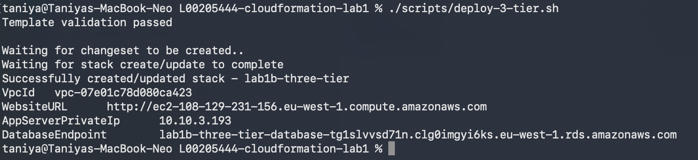
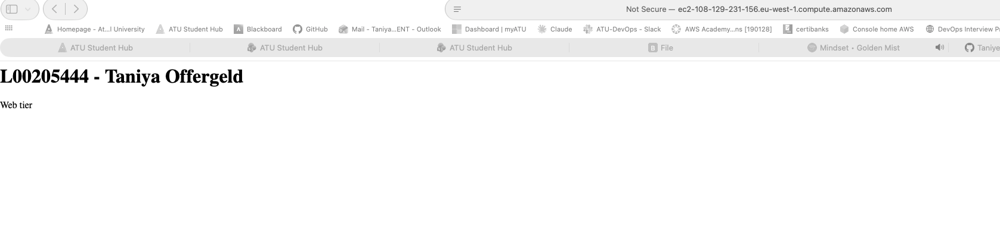
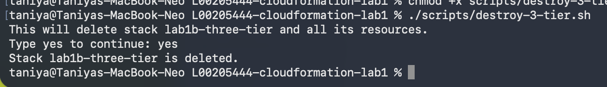

# CloudFormation Lab 1

**Student Name:** Taniya Offergeld
**Student Number:** L00205444
**Institution:** ATU Donegal
**Course:** PGDip in Computing in DevOps, IaC for DevOps Pipelines
**Lecturer:** R.G. Lennon
**Assignment:** CloudFormation Lab 

## 1. Introduction

In Part 1a I build a static website with CloudFormation. My L-number and name show as the header, the page is stored in an S3 bucket. This serves as a public facing web service hosts. In Part 1b I build a second setup with a web tier, an application tier and a database tier.

The main idea behind my work is automation. The brief is about infrastructure as code for DevOps pipelines, so I wanted to avoid clicking in the AWS console. Everything is in the repo: the templates, a deploy script and a destroy script. One command builds a setup and one command removes it. Section 6 explains my choices.

I keep each version as simple as possible and follow a tutorial first. Then I improve it one change at a time, each in its own branch and pull request. This README is part of that. I update it in pull requests as the work moves on, so the history shows my progress.

## 2. Status

| Part | Status |
|---|---|
| 1a, static website on S3 | Done, deployed and tested |
| 1a, deploy script | Done |
| 1a, destroy script | Done, tested with a real delete and a rebuild |
| 1b, three tier architecture | Done, deployed and tested |
| 1b, deploy script | Done |
| 1b, destroy script | Done, tested with a real delete |
| README write up | Final version (v4) |

### README versions
| Version | Branch | What it covers |
|---|---|---|
| v1 | docs/readme-v1-part-1a | Part 1a basics, deploy script, declarations so far |
| v1.1 | docs/readme-v1.1-formatting | Formatting fix |
| v2 | docs/readme-v2-part-1a-final | Part 1a finished, destroy script, LLM use |
| v3 | docs/readme-v3-three-tier | Part 1b three tier architecture |
| v4 | docs/readme-v4-final | Part 1b scripts, left out on purpose, best practice table, final write up |

## 3. Repository structure

```
.
├── README.md                          this write up
├── CODE_OF_CONDUCT.md
├── LICENSE
├── src/website/index.html             the static page (L-number and name as header)
├── scripts/
│   ├── deploy.sh                      Part 1a, deploys the stack and uploads the page
│   ├── destroy.sh                     Part 1a, empties the bucket and deletes the stack
│   ├── deploy-3-tier.sh               Part 1b, deploys the three tier stack
│   └── destroy-3-tier.sh              Part 1b, deletes the three tier stack
├── templates/
│   ├── s3-website/s3-website.yaml     Part 1a, website hosted from S3 (main version)
│   ├── website/static-website.yaml    Part 1a, first attempt with EC2 and Apache
│   └── three-tier/three-tier.yaml     Part 1b, web, app and database tiers
└── docs/images/                       screenshots
```

## 4. Part 1a: static website

### Version 1: the first attempt with EC2
My first template (`templates/website/static-website.yaml`) creates a private S3 bucket, a security group that allows port 80 only and an EC2 instance running Apache. I deployed it and the page loaded.


Main problem here was that the page is running on the EC2 server, so the bucket is never used. That does not meet "store the content in an S3 bucket". I kept the file in the repo to show the first version. I deleted the stack in AWS to avoid running cost.

### Version 2: website hosted from S3
The second template (`templates/s3-website/s3-website.yaml`) creates two things:
1. An S3 bucket with website hosting `index.html` is the home page.
2. A bucket policy that lets anyone read the files (`s3:GetObject` only).

The outputs give me the bucket name and the website address.

```
Browser  --HTTP-->  S3 website endpoint  -->  Bucket (index.html)
```


### How to deploy
The region is eu-west-1 (Ireland). The script uses the AWS CLI. I log in with `aws login` as the AWS root user of my account. This is not best practice, because the root user has full access to everything. For a real project I would use an IAM user with MFA and only the permissions it needs. I kept the root user for this lab to keep the setup simple. Run the script from the root of the repo:

```bash
./scripts/deploy.sh
```

The script validates the template, deploys the stack `lab1a-s3-website`, reads the bucket name from the stack outputs, uploads `index.html` and prints the website address. It uses the AWS CLI, so I log in first with `aws login`.

### How to delete
```bash
./scripts/destroy.sh
```

The script is based on Dhandala (2026b). It does these steps:
1. Checks that the stack exists. If it does not, it says so and stops.
2. Checks that termination protection is off.
3. Shows the resources that will be deleted and asks me to type `yes`.
4. Empties the bucket, because a stack cannot delete a bucket that still has files in it.
5. Deletes the stack and waits until it is gone.

I changed three things from the article. I empty the bucket first, I read the bucket name from the stack outputs like in `deploy.sh`, and I left out the export check because my stack has no exports.

### Testing the scripts
1. I ran `destroy.sh` and typed anything but `yes`. The script cancelled and the website still loaded.
2. I ran `destroy.sh` and typed `yes`. The bucket was emptied and the stack was deleted.
3. I ran `deploy.sh` again. The site came back from the repo with one command, on a new bucket and a new address, and the header showed my L-number and name.


## 5. Part 1b: three tier architecture

### What I built
One CloudFormation template (`templates/three-tier/three-tier.yaml`) builds a web tier, an application tier and a database tier, each in its own subnets with its own security group. I used Sofowoke (2024) as the base and kept its IP ranges, subnet layout and security group rules. I left out the parts that are not needed for a first version (see the table below). I built the template in three pull requests: network, security groups and the three tiers.

```
Internet
   |
Internet gateway
   |
Public subnets (10.10.1.0/24, 10.10.2.0/24)   <- web tier: one web server
   |
Private subnets (10.10.3.0/24, 10.10.4.0/24)  <- app tier: one server
   |
Private subnets (10.10.5.0/24, 10.10.6.0/24)  <- database tier: MySQL on RDS
```

| Tier | What it is | Subnets | Security group |
|---|---|---|---|
| Web | One `t3.micro` server running Apache. The page shows my L-number and name. | Public | Web group |
| App | One `t3.micro` server with no software | Private | App group |
| Database | MySQL 8.0 on `db.t3.micro`, 20 GB | Private (two availability zones, RDS needs this) | Database group |

### Security groups
These are the same rules as in the blog, except that I left out the bastion host.

| Group | Allows | From |
|---|---|---|
| Web | Ports 80, 22 and 3306, and ping | The internet (ping only from inside the VPC) |
| App | Port 80 | Anywhere |
| Database | Port 3306 | The web group |

### What I changed from the blog
| Area | The blog | My template | Why |
|---|---|---|---|
| NAT gateway | Yes | Left out | Costs money while it runs |
| Availability zones | Fixed to us-east-1 | Taken from the region | I work in eu-west-1 |
| Bastion host | Yes | Left out | Keeps it simple, so the app group has no SSH rule |
| Web tier | Auto scaling group behind a load balancer | One server | Keeps it simple |
| App tier | Second auto scaling group with the same Apache page | One plain server | There is no NAT gateway to install software |
| Load balancer and scaling policies | Yes | Left out | Keeps it simple |
| Server image | us-east-1 image, `amazon-linux-extras` | Current Amazon Linux 2023 image for the region, `dnf` | The blog's image does not exist in eu-west-1 |
| Instance type | `t2.micro` | `t3.micro` | `t2.micro` was not free tier eligible on my account |
| Web page | "Welcome To Swift Cart" | My L-number and name | The brief |
| Database security setting | Old `DBSecurityGroups` | `VPCSecurityGroups` | The old one is for EC2-Classic |
| Database size | `db.m6gd.large`, 15 GB | `db.t3.micro`, 20 GB | Cost, and 20 GB is the MySQL minimum |
| Database version | MySQL 8.0.35 | MySQL 8.0 | AWS picks a supported minor version |
| Outputs | None | Website address, database endpoint, app server IP, VPC ID | Easier to test |

### Known weaknesses
I list these because the brief asks me to think about security.
- Ports 22 and 3306 on the web group are open to the internet. They are open in the blog too. This needs to be reviewed
- The database password is a throwaway default in the template, because I wanted the deploy to run without typing it. The repo is public. It is a lab database that I delete after testing. A better way is to let RDS keep the password in Secrets Manager (`ManageMasterUserPassword`).
- The app group allows port 80 from anywhere, as in the blog. 

### How I deployed and deleted it
First I deployed and deleted the stack by hand with the AWS CLI. Then I wrote two scripts, in separate pull requests, and used those as in 1a

```bash
./scripts/deploy-3-tier.sh
./scripts/destroy-3-tier.sh
```

**`deploy-3-tier.sh`** is based on Dhandala (2026a) and on my own `deploy.sh` from Part 1a. It validates the template, deploys the stack `lab1b-three-tier` in eu-west-1 and prints the outputs. There is no file to upload, because the web page is in the template. The script also sets stack tags (`Project`, `Student`, `ManagedBy`), and CloudFormation copies them to the resources that support tags. The tags are in the script and not in the template.

**`destroy-3-tier.sh`** is based on Dhandala (2026b) and on my own `destroy.sh`. It checks that the stack exists, asks me to type `yes`, deletes the stack and waits until it is gone. There is no bucket to empty in this stack. I left out the termination protection check and the resource list to keep it simple.

The database costs money while it runs (about 13 dollars a month), so I delete the stack after testing. RDS leaves a database snapshot behind when a stack is deleted. The script does not delete it, so I delete the snapshot myself in the RDS console.

### Testing
My first two deploys failed because `t2.micro` was not free tier eligible on my account. I read the error in the stack events, changed the instance type to `t3.micro` and deployed again. Then:
- The web page loaded and showed my L-number and name.
- The EC2 list showed the web and app servers running. 
- The RDS list showed the database as available.


### Testing the scripts
I ran `deploy-3-tier.sh` and the stack was created. The web page loaded with my L-number and name.





I ran `destroy-3-tier.sh` and typed `yes`. The stack was deleted.



### What I left out on purpose
These parts of the blog are not in my template. I kept the first version simple.

| Left out | Why |
|---|---|
| Load balancer and auto scaling | One server per tier is enough to show the three tiers |
| NAT gateway | Costs money while it runs, so the app tier cannot reach the internet |
| Bastion host | Keeps it simple, so the app group has no SSH rule |
| Alarms and backups | Not needed for a lab that I delete after testing |

## 6. Automation and DevOps

### Why I used deploy and destroy scripts
I chose to write a deploy script and a destroy script for both parts because I wanted to automate as much as I could. Scripts do same actions every time they run and avoid human errors. They also keep the cost down, because a stack is easy to delete when I am finished.

### What the scripts automate
| Manual step | How I automated it | Where |
|---|---|---|
| Check the template for mistakes | `validate-template` runs first, before anything is created | all deploy scripts |
| Create or update the stack | `aws cloudformation deploy` does both and waits until it is finished | all deploy scripts |
| Upload the web page to the bucket | The script uploads `index.html` after the stack is ready | `deploy.sh` (1a) |
| Find the bucket name and website address | The script reads them from the stack outputs with `--query`, so I do not copy and paste | `deploy.sh`, `deploy-3-tier.sh` |
| Tag the resources | Stack tags are set in the command, and CloudFormation copies them to the resources | `deploy-3-tier.sh` |
| Empty the bucket before deleting | The script empties it, because a stack cannot delete a bucket with files in it | `destroy.sh` (1a) |
| Make sure I delete the right stack | The script checks that the stack exists and asks me to type `yes` | both destroy scripts |
| Wait for the delete to finish | `wait stack-delete-complete`, and a message if it fails | both destroy scripts |
| Stop when something goes wrong | `set -e` (and `set -euo pipefail` in the 1b deploy script) stops the script at the first error | all scripts |

### The result
- Part 1a: I deleted the whole website and brought it back from the repo with one command, on a new bucket and a new address. This is the proof that the setup is repeatable.
- Part 1b: the whole three tier stack, with network, servers and database, is built with `./scripts/deploy-3-tier.sh` and removed with `./scripts/destroy-3-tier.sh`. There is no manual work in the console.
- The 1b scripts reuse the pattern from the 1a scripts. That is why I kept them similar and listed the differences in their comments.

### How I worked, as a DevOps routine
- Every change is a small feature branch and a pull request, so the history shows what changed and why
- I do not delete merged branches, so the steps stay visible.
- The README grows with the work in numbered versions (v1 to v4).
- I tested the scripts before merging them and saved screenshots as evidence.


## 7. Branches and pull requests

| Branch | What it did |
|---|---|
| docs/add-code-of-conduct | Code of conduct |
| feature/add-index-page | Static page with my L-number and name |
| feature/s3-bucket-template | Private S3 bucket template |
| feature/web-service | EC2 web server (first version) |
| docs/add-screenshot | Screenshot of the first version |
| feature/s3-website-hosting | Website hosted from S3 (version 2) |
| feature/deploy-script | Deploy script |
| docs/readme-v1-part-1a | README version 1 |
| docs/readme-v1.1-formatting | README formatting fix |
| feature/destroy-script | Destroy script and screenshot of the test |
| docs/readme-v2-part-1a-final | README version 2 |
| feature/three-tier-network | Part 1b network (VPC, subnets, gateway, route tables) |
| feature/three-tier-security-groups | Part 1b security groups |
| feature/three-tier-instances-and-database | Part 1b web, app and database tiers |
| docs/readme-v3-three-tier | README version 3 |
| feature/three-tier-deploy-script | Part 1b deploy script, with stack tags |
| feature/three-tier-destroy-script | Part 1b destroy script and screenshot of the test |
| docs/readme-v4-final | README version 4 (this one) |

I do not delete merged branches, so the history stays visible.

## 8. Best practice (Part B)

### What I did
- Every template and script has comments that explain what each part does and where it came from.
- Both Part 1b scripts stop on the first error (`set -euo pipefail`) and do not hide the AWS error messages.
- The destroy scripts ask before they delete anything.
- Both setups can be deleted and rebuilt from the repo with one command each.
- The database group only accepts traffic from the web group.
- The three tiers are built in one template that I added to in small steps, so each pull request shows one change.
- I use feature branches and small pull requests, and I do not delete merged branches.


### Power tools
I used the AWS CLI (`validate-template` in both deploy scripts) and git with GitHub pull requests. I used an LLM (Claude) to help me plan, review and adapt the work. The details are in the LLM use section.


## 9. Declarations

### Tutorials and sources I followed
| Part | Source | What I used it for |
|---|---|---|
| 1a | Mozilla (n.d.) Your first website: Creating the content | HTML structure of `index.html` |
| 1a, version 1 | Techielass (n.d.) Create an S3 Bucket using AWS CloudFormation | Bucket settings in the EC2 version |
| 1a, version 1 | AWS CloudFormation Getting started walkthrough (Amazon Web Services, n.d.c) | Web server and security group in the EC2 version |
| 1a, version 2 | Le (2025) Project: S3 Static Website with CloudFormation | Main source for `s3-website.yaml` |
| 1a, version 2 | Setting permissions for website access (Amazon Web Services, n.d.a) | Check of the bucket policy |
| 1a, version 1 and 2 | AWS::S3::Bucket (Amazon Web Services, n.d.b) | Meaning of the bucket properties |
| 1a, deploy script | Davra (2022) Deploy a website with AWS S3 + CloudFront using CloudFormation | The pattern of validating, deploying and then uploading the page |
| 1a, deploy script | AWS CLI Command Reference, `cloudformation describe-stacks` (Amazon Web Services, n.d.d) | The `--query` and `--output text` options |
| 1a, destroy script | Dhandala (2026b) How to Delete CloudFormation Stacks Safely | The steps: check the stack, show what is deleted, ask, delete, wait |
| 1b, deploy script | Dhandala (2026a) How to Deploy CloudFormation Templates with the AWS CLI | The steps: validate, deploy with tags, print the outputs |
| 1b, destroy script | Dhandala (2026b) How to Delete CloudFormation Stacks Safely | The same steps as in 1a, without the bucket |
| 1b | Sofowoke (2024) Building and Deploying a 3-tier Architecture with AWS CloudFormation | Base for the whole template: IP ranges, subnet layout, security group rules |

### LLM use
I used Claude (Anthropic) during this lab, as the brief allows. It explained the assignment and helped me compare/evaluate tutorials. Claude helped me on feedback for my first versions of the EC2 template, the three tier template, `deploy.sh`, `destroy.sh`, `deploy-3-tier.sh`, `destroy-3-tier.sh` and this README. I adjusted and tweaked the scripts and templates, tested them, edited the text and made all commits and pull requests myself. The decisions were mine: I chose S3 hosting, picked the sources, decided what to keep and what to leave out (CloudFront and versioning). I chose the blog for Part 1b and planned the branches and pull requests. The idea to create destroy and deploy scripts were mine.

### What I changed to go further than the tutorials
- Added my L-number and name to the page and to the template descriptions.
- Moved from EC2 and Apache to S3 hosting, so the bucket really stores the site.
- Automated the whole path with scripts instead of the console: one command builds a setup and one removes it (section 6).
- Wrote a deploy script that reads the bucket name from the stack outputs, stops on any error and prints the website address.
- Wrote a destroy script that empties the bucket first, asks for confirmation and waits until the stack is gone.
- Proved the rebuild: I deleted the whole site and brought it back from the repo with one command.
- For Part 1b, split the blog's single template into steps and found that its security groups and database setting do not match its own design. I listed what I changed and what is still weak.
- Took out what I did not need (NAT gateway, bastion, load balancer, auto scaling) and explained why.
- Fixed the blog's region, image and instance type so it deploys in eu-west-1, and swapped the old database security group setting for the VPC one.
- Reused the same automation for the three tier stack: a deploy script that validates, deploys with tags and prints the outputs, and a destroy script that asks, deletes and waits.

## 11. References

Amazon Web Services (n.d.a) *Setting permissions for website access*. Available at: https://docs.aws.amazon.com/AmazonS3/latest/userguide/WebsiteAccessPermissionsReqd.html (Accessed: 15 October 2026).

Amazon Web Services (n.d.b) *AWS::S3::Bucket*. Available at: https://docs.aws.amazon.com/AWSCloudFormation/latest/TemplateReference/aws-resource-s3-bucket.html (Accessed: 15 October 2026).

Amazon Web Services (n.d.c) *Walkthrough: Creating your first stack*. Available at: https://docs.aws.amazon.com/AWSCloudFormation/latest/UserGuide/gettingstarted.walkthrough.html (Accessed: 15 October 2026).

Amazon Web Services (n.d.d) *describe-stacks*. AWS CLI Command