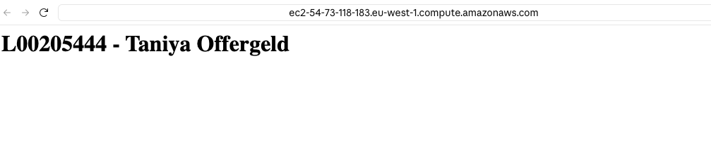
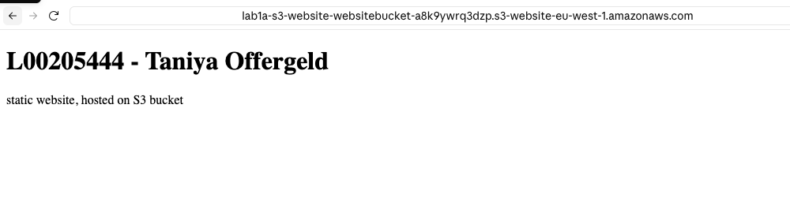

# CloudFormation Lab 1

**Student Name:** Taniya Offergeld
**Student Number:** L00205444
**Institution:** ATU Donegal
**Course:** PGDip in Computing in DevOps, IaC for DevOps Pipelines
**Lecturer:** R.G. Lennon
**Assignment:** CloudFormation Lab (Part A 1a and 1b, Part B best practice)

## 1. Introduction

This lab is about three tier architectures and using S3 as a data store for static web pages. In Part 1a I build a static website with CloudFormation. My L-number and name show as the header, the page is stored in an S3 bucket, and a public facing web service hosts it. In Part 1b I will build a second setup with a web tier, an application tier and a database tier.

I keep each version as simple as possible and follow a tutorial first. Then I improve it one change at a time, each in its own branch and pull request. This README is part of that. I update it in pull requests as the work moves on, so the history shows my progress.

## 2. Status

| Part | Status |
|---|---|
| 1a, static website on S3 | Working, deployed and tested |
| 1a, deploy script | Done |
| 1a, improvements | Planned (see section 8) |
| 1b, three tier architecture | Not started |
| README write up | In progress |

### README versions
| Version | Branch | What it covers |
|---|---|---|
| v1 | docs/readme-v1-part-1a | Part 1a basics, deploy script, declarations so far |
| v2 | docs/readme-v2-improvements | Part 1a improvements (planned) |
| v3 | docs/readme-v3-three-tier | Part 1b three tier architecture (planned) |
| v4 | docs/readme-v4-final | Best practice table, full prompt list, final screenshots (planned) |

## 3. Repository structure

```
.
├── README.md                          this write up
├── CODE_OF_CONDUCT.md
├── LICENSE
├── src/website/index.html             the static page (L-number and name as header)
├── scripts/deploy.sh                  deploys the stack and uploads the page
├── templates/
│   ├── s3-website/s3-website.yaml     Part 1a, website hosted from S3 (main version)
│   └── website/static-website.yaml    Part 1a, first attempt with EC2 and Apache
└── docs/images/                       screenshots
```

## 4. Part 1a: static website

### How I read the brief
The assignment says to store the static pages in an S3 bucket and to use a public facing web service to host the website. I read "public facing web service" as a service that serves the website to anyone on the internet. S3 static website hosting does that, so I used it for version 1. I plan to put CloudFront in front of a private bucket as an improvement, so S3 only stores the files and CloudFront is the public facing service.

### Version 1: the first attempt with EC2
My first template (`templates/website/static-website.yaml`) creates a private S3 bucket, a security group that allows port 80 only, and an EC2 instance running Apache. I deployed it and the page loaded.



It has a weakness. The page is typed into the start up script of the server, so the bucket is never used. That does not meet "store the content in an S3 bucket". I kept the file in the repo to show the first version, and I deleted the stack in AWS afterwards to avoid cost.

### Version 2: website hosted from S3
The second template (`templates/s3-website/s3-website.yaml`) creates two things:
1. An S3 bucket with website hosting switched on. `index.html` is the home page.
2. A bucket policy that lets anyone read the files (`s3:GetObject` only).

The outputs give me the bucket name and the website address.

```
Browser  --HTTP-->  S3 website endpoint  -->  Bucket (index.html)
```



This version has two weaknesses. The bucket is public, and the website address only works over HTTP. I plan to fix both with CloudFront.

### How to deploy
The region is eu-west-1 (Ireland). Run the script from the root of the repo:

```bash
./scripts/deploy.sh
```

The script validates the template, deploys the stack `lab1a-s3-website`, reads the bucket name from the stack outputs, uploads `index.html` and prints the website address. It uses the AWS CLI, so I log in first with `aws login`.

### How to delete
I empty the bucket first, because a stack cannot delete a bucket that still has files in it.

```bash
aws s3 rm s3://<BucketName> --recursive
aws cloudformation delete-stack --stack-name lab1a-s3-website --region eu-west-1
```

## 5. Part 1b: three tier architecture

Not started yet. I will add this section when I build it.

## 6. Branches and pull requests

| Branch | What it did |
|---|---|
| docs/add-code-of-conduct | Code of conduct |
| feature/add-index-page | Static page with my L-number and name |
| feature/s3-bucket-template | Private S3 bucket template |
| feature/web-service | EC2 web server (first version) |
| docs/add-screenshot | Screenshot of the first version |
| feature/s3-website-hosting | Website hosted from S3 (version 2) |
| feature/deploy-script | Deploy script |
| docs/readme-v1-part-1a | README version 1 |

I do not delete merged branches, so the history stays visible.

## 7. Best practice so far

- Every template and script has comments that explain what each part does and where it came from.
- The EC2 version uses parameters instead of fixed values, and opens port 80 only (no SSH).
- The bucket policy in version 2 allows `s3:GetObject` only, so visitors can read files but not change them.
- I check the templates with cfn-lint and work in VS Code.
- I use feature branches and small pull requests.

I will add a full table for security, scalability and performance when the improvements are done.

## 8. Still to do

- [ ] Fix the comments in `s3-website.yaml`
- [ ] 1a improvements, one branch each: tags, versioning and encryption, lint check on every pull request, CloudFront with HTTPS and a private bucket
- [ ] Part 1b: network, web tier, application tier, database tier, chained security groups
- [ ] 1b improvements
- [ ] Best practice table (security, scalability, performance)
- [ ] Delete the AWS stacks when I am finished

## 9. Declarations

### Tutorials and sources I followed
| Part | Source | What I used it for |
|---|---|---|
| 1a | Mozilla (n.d.) Your first website: Creating the content | HTML structure of `index.html` |
| 1a, version 1 | Techielass (n.d.) Create an S3 Bucket using AWS CloudFormation | Bucket settings in the EC2 version |
| 1a, version 1 | AWS CloudFormation Getting started walkthrough (Amazon Web Services, n.d.c) | Web server and security group in the EC2 version |
| 1a, version 2 | Le (2025) Project: S3 Static Website with CloudFormation | Main source for `s3-website.yaml` |
| 1a, version 2 | Setting permissions for website access (Amazon Web Services, n.d.a) | Check of the bucket policy |
| 1a, version 1 and 2 | AWS::S3::Bucket (Amazon Web Services, n.d.b) | Meaning of the bucket properties |
| 1a, deploy script | Davra (2022) Deploy a website with AWS S3 + CloudFront using CloudFormation | The pattern of validating, deploying and then uploading the page |
| 1a, deploy script | AWS CLI Command Reference, `cloudformation describe-stacks` (Amazon Web Services, n.d.d) | The `--query` and `--output text` options |

### LLM use
I used Claude (Anthropic) during this README.md and I declare it here as the brief asks.
- It explained the assignment and the concepts, helped me compare tutorials
- All commits and pull requests in this repository are made by me.

### What I changed to go further than the tutorials
- Added my L-number and name to the page and to the template descriptions.
- Moved from EC2 and Apache to S3 hosting, so the bucket really stores the site.
- Wrote a deploy script that reads the bucket name from the stack outputs, stops on any error and prints the website address.
- More changes will be listed here as I merge them.

## 10. References

Amazon Web Services (n.d.a) *Setting permissions for website access*. Available at: https://docs.aws.amazon.com/AmazonS3/latest/userguide/WebsiteAccessPermissionsReqd.html (Accessed: 15 October 2026).

Amazon Web Services (n.d.b) *AWS::S3::Bucket*. Available at: https://docs.aws.amazon.com/AWSCloudFormation/latest/TemplateReference/aws-resource-s3-bucket.html (Accessed: 15 October 2026).

Amazon Web Services (n.d.c) *Walkthrough: Creating your first stack*. Available at: https://docs.aws.amazon.com/AWSCloudFormation/latest/UserGuide/gettingstarted.walkthrough.html (Accessed: 15 October 2026).

Amazon Web Services (n.d.d) *describe-stacks*. AWS CLI Command Reference. Available at: https://docs.aws.amazon.com/cli/latest/reference/cloudformation/describe-stacks.html (Accessed: 15 October 2026).

Davra, N. (2022) *Deploy a website with AWS S3 + CloudFront using CloudFormation*. Canopas. Available at: https://canopas.com/deploy-a-website-with-aws-s3-cloudfront-using-cloudformation-c2199dc6c435 (Accessed: 15 October 2026).

Le, A. (2025) *Project: S3 Static Website with CloudFormation*. Medium. Available at: https://medium.com/@elnala24/project-s3-static-website-with-cloudformation-2253652b7405 (Accessed: 9 October 2026).

Mozilla (n.d.) *Your first website: Creating the content*. MDN Web Docs. Available at: https://developer.mozilla.org/en-US/docs/Learn_web_development/Getting_started/Your_first_website/Creating_the_content (Accessed: 15 October 2026).

Techielass (n.d.) *Create an S3 Bucket using AWS CloudFormation*. Available at: https://www.techielass.com/create-an-s3-bucket-using-aws-cloudformation/ (Accessed: 15 October 2026).
